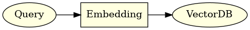
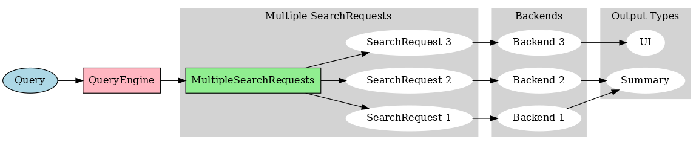
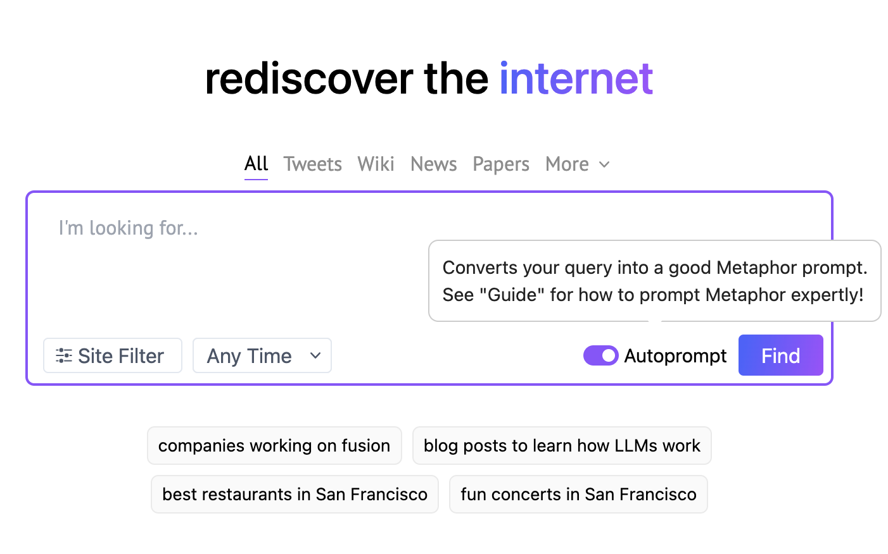

---
authors:
- jxnl
categories:
- LLM Techniques
comments: true
date: 2023-09-17
description: 'Explore how to enhance Retrieval Augmented Generation (RAG) with query
  understanding for smarter search solutions. '
draft: false
tags:
- RAG
- query understanding
- LLMs
- data modeling
- Pydantic
---

# RAG is more than just embedding search

With the advent of large language models (LLM), retrieval augmented generation (RAG) has become a hot topic. However throughout the past year of [helping startups](https://jxnl.co) integrate LLMs into their stack I've noticed that the pattern of taking user queries, embedding them, and directly searching a vector store is effectively demoware.

!!! note "What is RAG?"

    Retrieval augmented generation (RAG) is a technique that uses an LLM to generate responses, but uses a search backend to augment the generation. In the past year using text embeddings with a vector databases has been the most popular approach I've seen being socialized.

<figure markdown>
  
  <figcaption>Simple RAG that embedded the user query and makes a search.</figcaption>
</figure>

So let's kick things off by examining what I like to call the 'Dumb' RAG Model-a basic setup that's more common than you'd think.

<!-- more -->

## The 'Dumb' RAG Model

When you ask a question like, "what is the capital of France?" The RAG 'dumb' model embeds the query and searches in some unopinionated search endpoint. Limited to a single method API like `search(query: str) -> List[str]`. This is fine for simple queries, since you'd expect words like 'paris is the capital of france' to be in the top results of say, your wikipedia embeddings.

### Why is this a problem?

- **Query-Document Mismatch**: This model assumes that query embedding and the content embedding are similar in the embedding space, which is not always true based on the text you're trying to search over. Only using queries that are semantically similar to the content is a huge limitation!

- **Monolithic Search Backend**: Assumes a single search backend, which is not always the case. You may have multiple search backends, each with their own API, and you want to route the query to vector stores, search clients, sql databases, and more.
- **Limitation of text search**: Restricts complex queries to a single string (`{query: str}`), sacrificing expressiveness, in using keywords, filters, and other advanced features. For example, asking `what problems did we fix last week` cannot be answered by a simple text search since documents that contain `problem, last week` are going to be present at every week.

- **Limited ability to plan**: Assumes that the query is the only input to the search backend, but you may want to use other information to improve the search, like the user's location, or the time of day using the context to rewrite the query. For example, if you present the language model of more context it is able to plan a suite of queries to execute to return the best results.

Now let's dive into how we can make it smarter with query understanding. This is where things get interesting.

## Improving the RAG Model with Query Understanding

!!! note "Shoutouts"
Much of this work has been inspired by / done in collab with a few of my clients at [new.computer](https://new.computer), [Metaphor Systems](https://metaphor.systems), and [Naro](https://narohq.com), go check them out!

Ultimately what you want to deploy is a [system that understands](https://en.wikipedia.org/wiki/Query_understanding) how to take the query and rewrite it to improve precision and recall.

<figure markdown>
  
  <figcaption>Query Understanding system routes to multiple search backends.</figcaption>
</figure>

Not convinced? Let's move from theory to practice with a real-world example. First up, Metaphor Systems.

## What's instructor?

Instructor uses Pydantic to simplify the interaction between the programmer and language models via the function calling API.

- **Widespread Adoption**: Pydantic is a popular tool among Python developers.
- **Simplicity**: Pydantic allows model definition in Python.
- **Framework Compatibility**: Many Python frameworks already use Pydantic.

## Case Study 1: Metaphor Systems

Take [Metaphor Systems](https://metaphor.systems), which turns natural language queries into their custom search-optimized query. If you take a look web UI you'll notice that they have an auto-prompt option, which uses function calls to further optimize your query using a language model, and turns it into a fully specified metaphor systems query.

<figure markdown>

<figcaption>Metaphor Systems UI</figcaption>
</figure>

If we peek under the hood, we can see that the query is actually a complex object, with a date range, and a list of domains to search in. It's actually more complex than this but this is a good start. We can model this structured output in Pydantic using the instructor library

```python
class DateRange(BaseModel):
    start: datetime.date
    end: datetime.date


class MetaphorQuery(BaseModel):
    rewritten_query: str
    published_daterange: DateRange
    domains_allow_list: List[str]

    async def execute():
        return await metaphor.search(...)
```

Note how we model a rewritten query, range of published dates, and a list of domains to search in. This powerful pattern allows the user query to be restructured for better performance without the user having to know the details of how the search backend works.

```python
import instructor

# Enables response_model in the openai client
client = instructor.from_provider("openai/gpt-5-nano")

query = client.create(
    model="gpt-5.4-mini",
    response_model=MetaphorQuery,
    messages=[
        {
            "role": "system",
            "content": "You're a query understanding system for the Metafor Systems search engine. Here are some tips: ...",
        },
        {"role": "user", "content": "What are some recent developments in AI?"},
    ],
)
```

**Example Output**

```json
{
  "rewritten_query": "novel developments advancements ai artificial intelligence machine learning",
  "published_daterange": {
    "start": "2023-09-17",
    "end": "2021-06-17"
  },
  "domains_allow_list": ["arxiv.org"]
}
```

This isn't just about adding some date ranges. It's about nuanced, tailored searches, that are deeply integrated with the backend. Metaphor Systems has a whole suite of other filters and options that you can use to build a powerful search query. They can even use some chain of thought prompting to improve how they use some of these advanced features.

```python
class DateRange(BaseModel):
    start: datetime.date
    end: datetime.date
    chain_of_thought: str = Field(
        None,
        description="Think step by step to plan what is the best time range to search in",
    )
```

Now, let's see how this approach can help model an agent like personal assistant.

## Case Study 2: Personal Assistant

Another great example of this multiple dispatch pattern is a personal assistant. You might ask, "What do I have today?", from a vague query you might want events, emails, reminders etc. That data will likely exist in multiple backends, but what you want is one unified summary of results. Here you can't assume that text of those documents are all embedded in a search backend. There might be a calendar client, email client, across personal and profession accounts.

```python
class ClientSource(enum.Enum):
    GMAIL = "gmail"
    CALENDAR = "calendar"


class SearchClient(BaseModel):
    query: str
    keywords: List[str]
    email: str
    source: ClientSource
    start_date: datetime.date
    end_date: datetime.date

    async def execute(self) -> str:
        if self.source == ClientSource.GMAIL:
            ...
        elif self.source == ClientSource.CALENDAR:
            ...


class Retrieval(BaseModel):
    queries: List[SearchClient]

    async def execute(self) -> str:
        return await asyncio.gather(*[query.execute() for query in self.queries])
```

Now we can call this with a simple query like "What do I have today?" and it will try to async dispatch to the correct backend. It's still important to prompt the language model well, but we'll leave that for another day.

```python
import instructor

# Enables response_model in the openai client
client = instructor.from_provider("openai/gpt-5-nano")

retrieval = client.create(
    model="gpt-5.4-mini",
    response_model=Retrieval,
    messages=[
        {"role": "system", "content": "You are Jason's personal assistant."},
        {"role": "user", "content": "What do I have today?"},
    ],
)
```

**Example Output**

```json
{
    "queries": [
        {
            "query": None,
            "keywords": None,
            "email": "jason@example.com",
            "source": "gmail",
            "start_date": "2023-09-17",
            "end_date": None
        },
        {
            "query": None,
            "keywords": ["meeting", "call", "zoom"]]],
            "email": "jason@example.com",
            "source": "calendar",
            "start_date": "2023-09-17",
            "end_date": None

        }
    ]
}
```

Notice that we have a list of queries that route to different search backends (email and calendar). We can even dispatch them async to be as performance as possible. Not only do we dispatch to different backends (that we have no control over), but you are likely going to render them to the user differently as well. Perhaps you want to summarize the emails in text, but you want to render the calendar events as a list that they can scroll across on a mobile app.

!!! Note "Can I used framework X?"
I get this question a lot, but it's just code. Within these dispatches you can do whatever you want. You can use `input()` to ask the user for more information, make a post request, call a Langchain agent or LLamaindex query engine to get more information. The sky is the limit.

Both of these examples showcase how both search providers and consumers can use `instructor` to model their systems. This is a powerful pattern that allows you to build a system that can be used by anyone, and can be used to build an LLM layer, from scratch, in front of any arbitrary backend.

## Conclusion

This is not about fancy embedding tricks, it's just plain old information retrieval and query understanding. The beauty of instructor is that it simplifies modeling the complex and lets you define the output of the language model, the prompts, and the payload we send to the backend in a single place.

## What's Next?

Here I want to show that `instructor` isn’t just about data extraction. It’s a powerful framework for building a data model and integrating it with your LLM. Structured output is just the beginning - the untapped goldmine is skilled use of tools and APIs.

## Related Documentation
- [Validation Concepts](../../concepts/validation.md) - Validate RAG outputs

## See Also
- [LLM as Reranker](llm-as-reranker.md) - Improve search relevance
- [Citation Extraction](citations.md) - Verify sources
- [PDF Processing](chat-with-your-pdf-with-gemini.md) - Document handling

If you enjoy the content or want to try out `instructor` please check out the [github](https://github.com/jxnl/instructor) and give us a star!