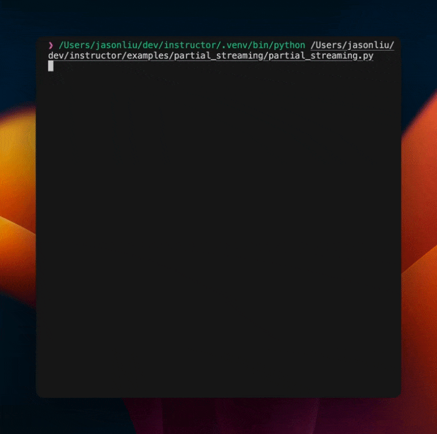

# Stream one Pydantic model with create_partial {#streaming-partial-responses}

Use `client.create_partial(response_model=User, ...)` to update a form or preview as fields arrive. Each result is a snapshot of the same object. To process a sequence of completed records, use [`create_iterable`](iterable.md).

!!! tip "Literal fields (optional / legacy)"

    You do **not** need `PartialLiteralMixin` anymore. Completeness-based validation handles
    incomplete `Literal` / `Enum` values during streaming automatically.

    `PartialLiteralMixin` still imports for older examples, but it is **deprecated** and raises a
    `DeprecationWarning` — safe to remove from new code.

Single-model Markdown JSON streams wait until the stream ends to select the last complete object or array. A fenced answer may arrive as a single snapshot. For incremental updates, use a native tool or structured output mode that streams field values.

## Understanding Partial Responses

Suppose both fields are required.

```python
from pydantic import BaseModel


class User(BaseModel):
    name: str
    age: int
```

Only the last of these prefixes is a complete JSON object.

```
{"name": "Jo
{"name": "John", "ag
{"name": "John", "age:
{"name": "John", "age": 25} # Completed
```

`create_partial` enables streaming and returns an iterator. The snapshots might look like this. Their number and contents depend on how the provider splits the response.

```
{"name": "Jo                 => User(name="Jo", age=None)
{"name": "John", "ag         => User(name="John", age=None)
{"name": "John", "age:       => User(name="John", age=None)
{"name": "John", "age": 25}  => User(name="John", age=25)
```

!!! warning "A snapshot can contain unvalidated values"

    Instructor constructs incomplete snapshots without running the original model's validators. Missing fields can be `None` or take their defaults. Nested objects can validate as they finish. Once the full object is complete, Instructor validates it against the original model and runs its validators.

    If the stream stops after `{"name": "John",`, the last snapshot can have `age=None`. If the LLM closes the object without supplying `age`, validation fails. In Markdown JSON, if the outer object is cut off, Instructor may select a complete object or array inside it.

This example redraws the meeting details in a terminal as they arrive.

```python
import instructor
from pydantic import BaseModel
from typing import List
from rich.console import Console

client = instructor.from_provider("openai/gpt-6-luna")

text_block = """
In our recent online meeting, participants from various backgrounds joined to discuss the upcoming tech conference. The names and contact details of the participants were as follows:

- Name: John Doe, Email: johndoe@email.com, Twitter: @TechGuru44
- Name: Jane Smith, Email: janesmith@email.com, Twitter: @DigitalDiva88
- Name: Alex Johnson, Email: alexj@email.com, Twitter: @CodeMaster2023

During the meeting, we agreed on several key points. The conference will be held on March 15th, 2024, at the Grand Tech Arena located at 4521 Innovation Drive. Dr. Emily Johnson, a renowned AI researcher, will be our keynote speaker.

The budget for the event is set at $50,000, covering venue costs, speaker fees, and promotional activities. Each participant is expected to contribute an article to the conference blog by February 20th.

A follow-up meeting is scheduled for January 25th at 3 PM GMT to finalize the agenda and confirm the list of speakers.
"""


class User(BaseModel):
    name: str
    email: str
    twitter: str


class MeetingInfo(BaseModel):
    users: List[User]
    date: str
    location: str
    budget: int
    deadline: str


extraction_stream = client.create_partial(
    response_model=MeetingInfo,
    messages=[
        {
            "role": "user",
            "content": f"Get the information about the meeting and the users {text_block}",
        },
    ],
    stream=True,
)


console = Console()

for extraction in extraction_stream:
    obj = extraction.model_dump()
    console.clear()
    console.print(obj)

print(extraction.model_dump_json(indent=2))
"""
{
  "users": [
    {
      "name": "John Doe",
      "email": "johndoe@email.com",
      "twitter": "@TechGuru44"
    },
    {
      "name": "Jane Smith",
      "email": "janesmith@email.com",
      "twitter": "@DigitalDiva88"
    },
    {
      "name": "Alex Johnson",
      "email": "alexj@email.com",
      "twitter": "@CodeMaster2023"
    }
  ],
  "date": "March 15th, 2024",
  "location": "Grand Tech Arena, 4521 Innovation Drive",
  "budget": 50000,
  "deadline": "February 20th"
}
"""
```

This will output the following:



## Defaults during streaming

With Pydantic 2.10 or later, a `default_factory` can accept the already validated
values of earlier fields. During streaming, those values may still be incomplete
or unvalidated. In the example below, a missing `username` stays `None` in partial
snapshots until its containing object is complete and validated.

```python
from pydantic import BaseModel, Field


class User(BaseModel):
    email: str
    username: str = Field(default_factory=lambda data: data["email"].split("@")[0])
```

For `{"email":"alice@example.com"}`, intermediate snapshots leave `username` as
`None`; the completed result has `username="alice"`. A completed nested object
can compute its defaults before the outer object finishes. An explicitly supplied
`username` is kept. Ordinary defaults and zero-argument factories, such as
`Field(default_factory=list)`, remain available in partial snapshots.

## Asynchronous Streaming

Set `async_client=True` and iterate over `client.create_partial(...)` with `async for`.

```python
import instructor
from pydantic import BaseModel

client = instructor.from_provider(
    "openai/gpt-6-luna",
    async_client=True,
)


class User(BaseModel):
    name: str
    age: int


async def print_partial_results():
    user = client.create_partial(
        response_model=User,
        max_retries=2,
        stream=True,
        messages=[
            {"role": "user", "content": "Jason is 12 years old"},
        ],
    )
    async for m in user:
        print(m)
        #> name=None age=None
        #> name=None age=None
        #> name=None age=None
        #> name='' age=None
        #> name='Jason' age=None
        #> name='Jason' age=None
        #> name='Jason' age=None
        #> name='Jason' age=None
        #> name='Jason' age=12
        #> name='Jason' age=12


import asyncio

asyncio.run(print_partial_results())
```

## Concurrent requests and direct handlers

The core runtime passes each request's `stream` boolean explicitly. OpenAI-compatible,
Anthropic, Mistral, and xAI mode handlers honor that value even when another request
using the same model prepared a stream, failed, or was cancelled. This routing rule
does not change each provider's event format or output type.

When calling those handlers directly, pass `stream=True` or `stream=False` to
`parse_response` for overlapping requests. Omitting `stream` preserves the legacy
one-shot inference from `prepare_request`. That fallback is keyed by model class
and cannot distinguish overlapping calls using the same class. Explicit parsing
also retires a pending legacy marker; do not mix explicit and implicit parsing
for overlapping calls with the same model.

If you stop reading snapshots early, call `close()` on the generator or `await aclose()` on the async generator. The partial parser then closes the underlying stream if it supports closing. With OpenAI-compatible handlers, catch validation errors around the loop. Handlers that collect all snapshots before returning can raise during `parse_response`.

The native xAI client has a separate SDK streaming path; the shared routing rule
here concerns its registry mode handlers. Providers without class-keyed stream
markers retain their existing routing. Async request preparation still performs
synchronous cache and media operations; this change does not offload them or alter
remote-media connection checks.

## See Also

- [Streaming Lists](./lists.md) - Stream collections of completed objects
- [Streaming Basics](../learning/streaming/basics.md) - Introduction to streaming concepts
- [Iterable Streaming](./iterable.md) - Stream multiple objects
- [Raw Response](./raw_response.md) - Access original LLM responses
